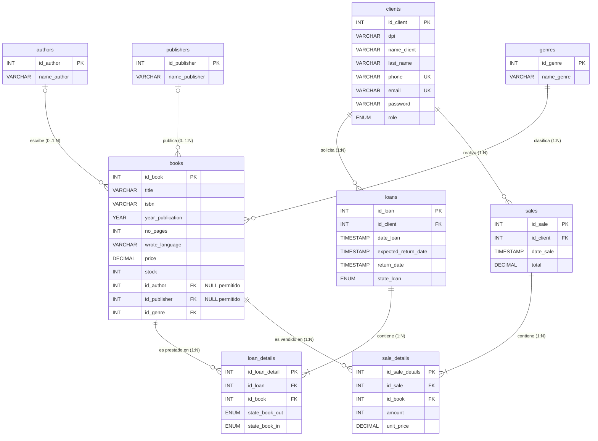

# Base de Datos - Minerva Lib 

## 1. Objetivo de la Base de Datos

El objetivo principal de la base de datos `minerva_lib_db` es centralizar, estructurar y controlar de forma consistente y relacional todas las operaciones bibliográficas, comerciales y de préstamo del sistema Minerva Lib.

Específicamente, está diseñada para:
1. **Gestión del Catálogo Bibliográfico:** Registrar y clasificar obras literarias asociadas a sus respectivos autores, casas editoriales y géneros literarios, manteniendo el control de inventario (`stock`) y precios unitarios.
2. **Administración de Clientes:** Mantener el padrón de usuarios y clientes identificados formalmente mediante documentos de identidad (DPI), información de contacto y correo electrónico único.
3. **Ciclo de Vida de Préstamos:** Administrar los préstamos bibliotecarios registrando la fecha de entrega, fecha esperada de devolución, fecha de recepción real, estado general del préstamo y la inspección física del estado de conservación de los libros (al salir y al regresar).
4. **Operaciones Comerciales (Ventas):** Registrar transacciones de compra de libros con detalle de unidades adquiridas, precio unitario histórico facturado y cálculo de montos totales.

---

## 2. Diagramas del Modelo

El modelo de datos se encuentra documentado visualmente en los siguientes artefactos:
- **Diagrama Conceptual / Lógico (draw.io):** [`database/diagram/dio_minerva_lib.png`](./diagram/dio_minerva_lib.png)
- **Diagrama Físico / Relacional (MySQL Workbench):** [`database/diagram/wkb_minerva_lib.png`](./diagram/wkb_minerva_lib.png)

### Diagrama Entidad-Relación (Mermaid)



---

## 3. Entidades y Atributos

A continuación se detalla cada una de las 9 tablas que conforman el esquema relacional:

### 3.1. `authors` (Autores)
Almacena los autores de las obras literarias.
| Atributo | Tipo de Dato | Nulo | Clave | Descripción |
| :--- | :--- | :---: | :---: | :--- |
| `id_author` | `INT` | NO | **PK** | Identificador único autoincremental del autor. |
| `name_author` | `VARCHAR(50)` | NO | - | Nombre completo del autor. |

### 3.2. `publishers` (Editoriales)
Almacena las casas editoriales encargadas de publicar los libros.
| Atributo | Tipo de Dato | Nulo | Clave | Descripción |
| :--- | :--- | :---: | :---: | :--- |
| `id_publisher` | `INT` | NO | **PK** | Identificador único autoincremental de la editorial. |
| `name_publisher` | `VARCHAR(50)` | NO | - | Nombre de la editorial. |

### 3.3. `genres` (Géneros Literarios)
Categorización temática de las obras literarias.
| Atributo | Tipo de Dato | Nulo | Clave | Descripción |
| :--- | :--- | :---: | :---: | :--- |
| `id_genre` | `INT` | NO | **PK** | Identificador único autoincremental del género. |
| `name_genre` | `VARCHAR(50)` | NO | - | Nombre del género (p. ej. Ficción, Realismo Mágico). |

### 3.4. `books` (Libros / Inventario)
Catálogo general de títulos disponibles tanto para préstamo como para venta.
| Atributo | Tipo de Dato | Nulo | Clave | Descripción |
| :--- | :--- | :---: | :---: | :--- |
| `id_book` | `INT` | NO | **PK** | Identificador único autoincremental del libro. |
| `title` | `VARCHAR(50)` | NO | - | Título de la obra. |
| `isbn` | `VARCHAR(20)` | NO | - | Código internacional normalizado para libros. |
| `year_publication` | `YEAR` | NO | - | Año en que se publicó la edición. |
| `no_pages` | `INT` | NO | - | Número total de páginas. |
| `wrote_language` | `VARCHAR(50)` | NO | - | Idioma original o de edición de la obra. |
| `price` | `DECIMAL(6,2)` | NO | - | Precio unitario actual de venta (hasta 9,999.99). |
| `stock` | `INT` | NO | - | Existencias físicas disponibles en almacén. |
| `id_author` | `INT` | SÍ | **FK** | Referencia opcional al autor (`authors.id_author`); `NULL` cuando no se conoce o no se registra. |
| `id_publisher` | `INT` | SÍ | **FK** | Referencia opcional a la editorial (`publishers.id_publisher`); `NULL` cuando no se conoce o no se registra. |
| `id_genre` | `INT` | NO | **FK** | Referencia al género (`genres.id_genre`). |

### 3.5. `clients` (Clientes y Lectores)
Registro de personas individuales facultadas para solicitar préstamos o realizar compras.
| Atributo | Tipo de Dato | Nulo | Clave | Descripción |
| :--- | :--- | :---: | :---: | :--- |
| `id_client` | `INT` | NO | **PK** | Identificador único autoincremental del cliente. |
| `dpi` | `VARCHAR(13)` | NO | - | Documento Personal de Identificación (obligatorio, exactamente 13 dígitos). |
| `name_client` | `VARCHAR(50)` | NO | - | Nombres del cliente. |
| `last_name` | `VARCHAR(50)` | NO | - | Apellidos del cliente. |
| `phone` | `VARCHAR(8)` | NO | **UK** | Número telefónico de contacto (obligatorio, único, exactamente 8 dígitos). |
| `email` | `VARCHAR(255)` | NO | **UK** | Correo electrónico de contacto (obligatorio, único). |
| `password` | `VARCHAR(255)` | NO | - | Hash unidireccional de la contraseña (bcrypt) para autenticación. |
| `role` | `ENUM('client', 'admin')` | NO | - | Rol de control de acceso RBAC (Default `'client'`). |

### 3.6. `loans` (Préstamos)
Encabezado de la transacción de préstamo bibliotecario.
| Atributo | Tipo de Dato | Nulo | Clave | Descripción |
| :--- | :--- | :---: | :---: | :--- |
| `id_loan` | `INT` | NO | **PK** | Identificador único autoincremental del préstamo. |
| `id_client` | `INT` | NO | **FK** | Cliente que realiza el préstamo (`clients.id_client`). |
| `date_loan` | `TIMESTAMP` | NO | - | Fecha y hora en que se emite el préstamo (Default `CURRENT_TIMESTAMP`). |
| `expected_return_date` | `TIMESTAMP` | NO | - | Fecha límite programada para la devolución. |
| `return_date` | `TIMESTAMP` | SÍ | - | Fecha real de devolución (`NULL` mientras esté activo). |
| `state_loan` | `ENUM('activo', 'devuelto')` | NO | - | Estado actual del préstamo (Default `'activo'`). |

### 3.7. `loan_details` (Detalle de Préstamos)
Entidad asociativa que desglosa los libros prestados por cada transacción y su estado físico.
| Atributo | Tipo de Dato | Nulo | Clave | Descripción |
| :--- | :--- | :---: | :---: | :--- |
| `id_loan_detail` | `INT` | NO | **PK** | Identificador único autoincremental del renglón de detalle. |
| `id_loan` | `INT` | NO | **FK** | Referencia al préstamo encabezado (`loans.id_loan`). |
| `id_book` | `INT` | NO | **FK** | Referencia al libro prestado (`books.id_book`). |
| `state_book_out` | `ENUM('Excelente', 'Regular', 'Maltratado')` | NO | - | Condición física del ejemplar al salir de la biblioteca. |
| `state_book_in` | `ENUM('Excelente', 'Regular', 'Maltratado')` | SÍ | - | Condición física al ser devuelto (`NULL` mientras esté activo). |

### 3.8. `sales` (Ventas)
Encabezado de la transacción comercial / facturación.
| Atributo | Tipo de Dato | Nulo | Clave | Descripción |
| :--- | :--- | :---: | :---: | :--- |
| `id_sale` | `INT` | NO | **PK** | Identificador único autoincremental de la venta. |
| `id_client` | `INT` | NO | **FK** | Cliente que realiza la compra (`clients.id_client`). |
| `date_sale` | `TIMESTAMP` | NO | - | Fecha y hora de la transacción (Default `CURRENT_TIMESTAMP`). |
| `total` | `DECIMAL(6,2)` | NO | - | Monto monetario total cobrado en la venta. |

### 3.9. `sale_details` (Detalle de Ventas)
Entidad asociativa que desglosa los ítems vendidos en una transacción.
| Atributo | Tipo de Dato | Nulo | Clave | Descripción |
| :--- | :--- | :---: | :---: | :--- |
| `id_sale_details` | `INT` | NO | **PK** | Identificador único autoincremental del renglón de venta. |
| `id_sale` | `INT` | NO | **FK** | Referencia a la venta encabezado (`sales.id_sale`). |
| `id_book` | `INT` | NO | **FK** | Referencia al libro vendido (`books.id_book`). |
| `amount` | `INT` | NO | - | Cantidad de unidades vendidas de este título. |
| `unit_price` | `DECIMAL(6,2)` | NO | - | Precio unitario facturado al momento de la venta. |

---

## 4. Relaciones y Cardinalidades

| Entidad Origen | Entidad Destino | Tipo de Relación | Cardinalidad Origen:Destino | Participación (Min, Max) | Explicación del Vínculo |
| :--- | :--- | :---: | :---: | :---: | :--- |
| **authors** | **books** | 1 a N | `1 : N` | `(0,N)` a `(0,1)` | Un autor puede tener cero o muchos libros; cada libro puede tener cero o un autor registrado. |
| **publishers** | **books** | 1 a N | `1 : N` | `(0,N)` a `(0,1)` | Una editorial puede publicar cero o muchos libros; cada libro puede tener cero o una editorial registrada. |
| **genres** | **books** | 1 a N | `1 : N` | `(1,1)` a `(1,N)` | Un género literario puede agrupar múltiples libros; cada libro se clasifica bajo un género principal. |
| **clients** | **loans** | 1 a N | `1 : N` | `(0,N)` a `(1,1)` | Un cliente puede tener cero, uno o múltiples préstamos en el tiempo; un préstamo corresponde a un único cliente. |
| **loans** | **loan_details** | 1 a N | `1 : N` | `(1,N)` a `(1,1)` | Un préstamo agrupa uno o varios libros prestados; cada detalle pertenece exclusivamente a un préstamo. |
| **books** | **loan_details** | 1 a N | `1 : N` | `(0,N)` a `(1,1)` | Un libro puede prestarse en múltiples ocasiones; cada registro de detalle referencia a un ejemplar de libro. *(Resuelve relación N:M entre `loans` y `books`)*. |
| **clients** | **sales** | 1 a N | `1 : N` | `(0,N)` a `(1,1)` | Un cliente puede efectuar múltiples compras o ninguna; una venta está asignada a un solo cliente. |
| **sales** | **sale_details** | 1 a N | `1 : N` | `(1,N)` a `(1,1)` | Una venta se compone de uno o más ítems facturados; cada detalle pertenece a una única venta. |
| **books** | **sale_details** | 1 a N | `1 : N` | `(0,N)` a `(1,1)` | Un libro puede venderse en distintas transacciones; cada línea de detalle hace referencia a un libro. *(Resuelve relación N:M entre `sales` y `books`)*. |

---

## 5. Restricciones e Integridad de Datos

### 5.1. Claves Primarias (`PRIMARY KEY`)
- Todas las tablas implementan una clave primaria simple de tipo entero con incremento automático (`INT PRIMARY KEY AUTO_INCREMENT`), garantizando identificadores únicos libres de colisiones.

### 5.2. Integridad Referencial y Reglas de Cascada (`FOREIGN KEY`)
| Clave Foránea | Tabla Referenciada | ON UPDATE | ON DELETE | Justificación de Negocio |
| :--- | :--- | :---: | :---: | :--- |
| `books(id_author)` | `authors(id_author)` | `CASCADE` | `SET NULL` | Si se elimina un autor, se conservan sus libros y se limpia su referencia; si cambia su ID, se actualiza la referencia. |
| `books(id_publisher)` | `publishers(id_publisher)` | `CASCADE` | `SET NULL` | Si se elimina una editorial, se conservan sus libros y se limpia su referencia; si cambia su ID, se actualiza la referencia. |
| `books(id_genre)` | `genres(id_genre)` | `CASCADE` | `RESTRICT` | **Protección de catálogo:** Evita eliminar un género literario si existen libros clasificados en él. |
| `loans(id_client)` | `clients(id_client)` | `RESTRICT` | `RESTRICT` | Evita eliminar accidentalmente un cliente que tenga un historial de préstamos activo. |
| `loan_details(id_loan)` | `loans(id_loan)` | `CASCADE` | `CASCADE` | Si se anula un préstamo, sus ítems desglosados se eliminan en cascada. |
| `loan_details(id_book)` | `books(id_book)` | `CASCADE` | `CASCADE` | Propaga modificaciones de libros sobre el desglose de préstamos. |
| `sales(id_client)` | `clients(id_client)` | `CASCADE` | `CASCADE` | Los cambios de cliente se propagan a las ventas asociadas. |
| `sale_details(id_sale)` | `sales(id_sale)` | `RESTRICT` | `RESTRICT` | Preserva la consistencia de auditoría fiscal en renglones de venta. |
| `sale_details(id_book)` | `books(id_book)` | `RESTRICT` | `RESTRICT` | Evita eliminar del catálogo libros que ya fueron facturados históricamente. |

### 5.3. Restricciones de Unicidad (`UNIQUE`)
- **`clients.email`:** Garantiza que no existan cuentas duplicadas asociadas al mismo correo electrónico.
- **`clients.phone`:** Garantiza que el número de teléfono de contacto sea único por cada cliente registrado.

### 5.4. Restricciones de Validación (`CHECK`)
- **`clients.dpi`:** `CHECK(CHAR_LENGTH(dpi) = 13)` asegura que el documento de identificación sea obligatorio (`NOT NULL`) y cuente exactamente con 13 caracteres numéricos según el estándar de DPI de Guatemala.
- **`clients.phone`:** `CHECK(CHAR_LENGTH(phone) = 8)` asegura que el número telefónico cuente exactamente con 8 dígitos según el estándar de numeración de Guatemala.

### 5.5. Dominios Enumerados (`ENUM`)
- **`loans.state_loan`:** Restringido a valores fijos `['activo', 'devuelto']`.
- **`loan_details.state_book_out` y `state_book_in`:** Restringido a valores cualitativos de conservación física `['Excelente', 'Regular', 'Maltratado']`.

### 5.6. Fechas y Valores por Defecto (`DEFAULT`)
- **`loans.date_loan` y `sales.date_sale`:** Asignan automáticamente la estampa temporal actual del sistema (`CURRENT_TIMESTAMP`).
- **`loans.state_loan`:** Se inicializa en `'activo'` por defecto al crear el préstamo.
- **`loans.return_date` y `loan_details.state_book_in`:** Se inicializan en `NULL`, indicando que la devolución está pendiente.

---

## 6. Supuestos de Negocio

1. **Contexto Regional y Validación Estricta de Clientes:**
   - La base de datos asume el contexto nacional de **Guatemala**, exigiendo de forma obligatoria (`NOT NULL`) un documento de identificación (`dpi`) de exactamente 13 caracteres numéricos, así como un número de teléfono (`phone`) único de longitud fija de 8 dígitos.
2. **Autoría y Edición Única por Libro:**
   - Cada registro en `books` modela una edición concreta que pertenece a un único autor principal, una editorial y un género literario principal (relación 1 a N). No se contempla autoría múltiple en esta fase del modelo.
3. **Persistencia del Precio Histórico de Venta:**
   - La tabla `sale_details` guarda explícitamente el campo `unit_price`. Esto asegura que si el precio en `books.price` se actualiza en el futuro, el comprobante y el historial contable de la venta no se vean alterados.
4. **Inspección Física y Control de Daños en Préstamos:**
   - Se asume un flujo de control de calidad: al prestarse el libro se evalúa su estado (`state_book_out`), y al momento de la devolución se registra obligatoriamente el estado final (`state_book_in`), permitiendo detectar si un ejemplar fue maltratado durante el préstamo.
5. **Separación de Préstamo y Venta:**
   - El catálogo `books` es polivalente: los libros en existencia (`stock`) pueden destinarse tanto para venta comercial como para préstamo en sala o a domicilio.
6. **Límite Monetario:**
   - Los campos de tipo monetario (`price`, `total`, `unit_price`) utilizan el tipo `DECIMAL(6,2)`, soportando cifras de hasta Q 9,999.99 (nueve mil novecientos noventa y nueve con noventa y nueve centavos).
7. **Autoría y editorial desconocidas:**
   - `books.id_author` e `id_publisher` admiten `NULL` cuando no se cuenta con ese dato. `NULL` significa “sin dato registrado”; no se debe insertar un autor o editorial ficticios para cubrir ese caso.
   - Si la obra está identificada explícitamente como anónima, se registra un autor con `name_author = 'Anónimo'` y se asigna su `id_author` al libro. Así se distingue una autoría anónima conocida de una autoría desconocida.

   ```sql
   -- Si la obra es explícitamente anónima:
   INSERT INTO authors (name_author) VALUES ('Anónimo');
   -- Usar el id_author generado al registrar el libro.

   -- Si no se conoce el autor o la editorial, usar NULL en la referencia
   -- correspondiente al registrar el libro.
   ```

---

## 7. Despliegue y Administración con Docker

La base de datos se despliega automáticamente mediante Docker Compose:

### 7.1. Inicialización Automática
Al levantar el contenedor por primera vez, el motor ejecuta en orden alfabético los scripts montados en `/docker-entrypoint-initdb.d/`:
1. `database/script/01-init.sql`: Crea la base de datos `minerva_lib_db` y las 9 tablas con sus claves primarias, foráneas, índices y restricciones `CHECK`.
2. `database/script/02-seed.sql`: Inserta los registros semilla para autores, editoriales, géneros, libros y clientes de prueba.

`01-init.sql` elimina y vuelve a crear la base de datos. Los scripts de inicialización solo se ejecutan automáticamente cuando MySQL inicia con un directorio de datos vacío; no se debe volver a ejecutar este script en una base con datos que se quieran conservar.

### 7.2. Comandos Operativos

* **Levantar solo la base de datos:**
  ```bash
  docker compose up -d db
  ```
* **Acceder a la consola interactiva de MySQL:**
  ```bash
  docker exec -it minerva_mysql mysql -u root -p
  # Ingresar la contraseña definida en .env (por defecto: secretpassword)
  ```
* **Consultas rápidas desde la consola interactiva:**
  ```sql
  USE minerva_lib_db;
  SHOW TABLES;
  SELECT * FROM books;
  SELECT id_client, name_client, email, role FROM clients;
  ```
* **Reiniciar base de datos limpia (eliminar volumen y re-ejecutar seeds):**
  ```bash
  docker compose down -v
  docker compose up -d db
  ```
